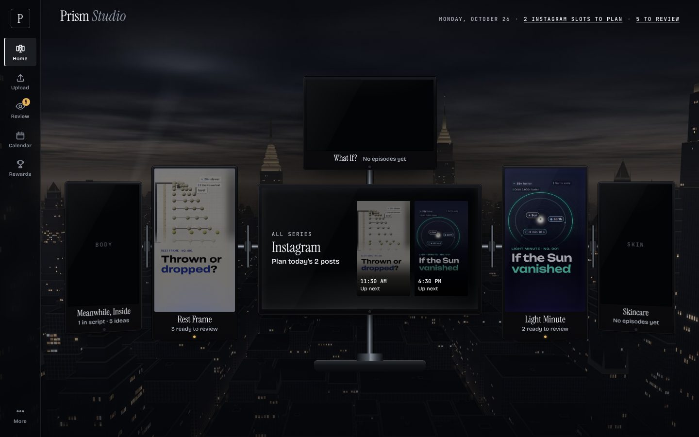

# Prism Studio

A phone-first studio for five educational channels: **Skincare**, **Rest Frame** (physics), **Meanwhile, Inside**
(human body), **Light Minute** (space) and **What If?**. It publishes to 11 places: one YouTube channel and one
TikTok account per channel, plus one shared Instagram.

It tracks every episode from idea to published and binds each approval to an exact video and text for one account.
Home is a wall of six monitors: the shared Instagram in the middle and one screen per channel. Each screen holds the
next post for every account it feeds, ready to copy, download and mark uploaded. Publishing is manual until a
platform is connected (Stage C). The studio also keeps analytics, costs, notifications, milestones, an optional
owner-funded reward budget, and a living creation per channel that evolves with real work.



More screens, with captions: [`docs/preview-gallery/index.html`](docs/preview-gallery/index.html) (`npm run preview`
retakes them). The five creations: [`docs/creations.png`](docs/creations.png).

## Run it

```bash
service postgresql start                       # local Postgres 16
cp .env.example .env.local                     # then fill in the values below
npm install
npm run owner:password -- "your passphrase"    # prints OWNER_PASSWORD_HASH for .env.local
openssl rand -hex 32                           # SESSION_SECRET for .env.local
npm run db:migrate && npm run db:seed && npm run import:episodes
npm run dev                                    # http://localhost:3100
npm run worker                                 # second terminal: background jobs
```

Checks: `npm run typecheck`, `npm test` (needs `TEST_DATABASE_URL`; it wipes that database, never the studio's),
`npx next build`. On a shared machine, run the build with `nice -n 10`.

## Commands

| Command | What it does |
|---|---|
| `npm run dev` / `npm run worker` | The app on port 3100 / the job runner (publishing, analytics pulls, notifications, housekeeping) |
| `npx next build && npm start` | The production build on port 3100 (`npm start -- -p 3107` for another), run by Next's standalone server as in the Docker image: `scripts/start.mjs` puts `.next/static` and `public` beside `server.js` and reads `.env.local` (not `next start`, which doesn't support standalone output) |
| `npm run db:migrate` / `db:seed` | Apply migrations / add channels, destinations and rules (safe to repeat; `-- --demo` adds a labelled demo series) |
| `npm run import:episodes` | Bring rendered episodes in from `films/channels` (also Queue → Import rendered episodes) |
| `npm run covers` | Draw the 9:16 cover and 16:9 thumbnail for each delivered episode (films machine: Chromium + ffmpeg) |
| `npm run text:regenerate` | Rewrite every current version's posting text from the script and sources |
| `npm run text:pack` | Write `out/POSTING.md` and `posting.json` next to each delivered episode |
| `npm run preview` | Retake the screenshots in `docs/preview-gallery/` from a production build on the dev database |
| `npm run wallpaper` | Re-render the skyline wallpaper (`public/wallpaper/README.md`) |
| `npm run owner:password` | Print an `OWNER_PASSWORD_HASH` for a passphrase |
| `npm run db:reset -- --yes` | Empty the dev database, seed it and import again (refuses unless the database is on localhost) |

## Where things are

| Path | What |
|---|---|
| `src/db/schema.ts` | Every business fact (39 tables). Times are UTC; money is integer cents; production budgets and costs are separate from rewards |
| `src/domain/` | The rules: episodes and states, approvals, publications, schedule and the Instagram rotation, posting text and written forms, rewards, the living studio, jobs, time, publishing, API analytics, costs, push notifications, sign-in protection |
| `src/app/(studio)/` | Screens: the wall (`/`), a screen per monitor (`/m/[slug]`), Upload Desk, Review, Calendar, Rewards, channels, episodes, evolution, analytics, accounts, queue, learn, costs, settings |
| `src/app/actions.ts` | Every mutation (server actions, zod-validated, owner-checked) |
| `src/app/api/` | Media with HTTP Range, the SRT captions, the per-task ZIP bundle, OAuth callbacks, signed public media for Instagram, push subscriptions, health |
| `src/integrations/` | YouTube, TikTok and Instagram clients (pure, with injected `fetch`) |
| `src/lib/rig.ts` | Which channel sits on which monitor |
| `src/creations/` | The five creations, drawn as inline SVG (forms 1–5, branches, ascended, reveal) |
| `worker/` | The job runner and housekeeping (expired leases, missed slots, due publications, analytics pulls, notifications) |
| `scripts/` | migrate, seed, import, covers, posting text, preview, wallpaper, owner password, dev reset |
| `deploy/`, `Dockerfile`, `docker-compose.yml` | One server: Postgres, the web app, the worker, nightly backups, Caddy (HTTPS); `deploy/DEPLOY.md` |
| `tests/` | Vitest: the failure paths (approvals, double counting, money, queue, DST, URLs, traversal, connectors, sign-in, notifications) |

`RUNBOOK.md` covers day-to-day operation, `DECISIONS.md` why things are the way they are, `INTEGRATIONS.md` the
platform links and conditions, `PROJECT_STATE.md` what's done and what needs the owner, and `CHANGELOG.md` what
changed when.
