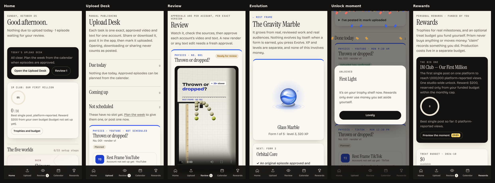
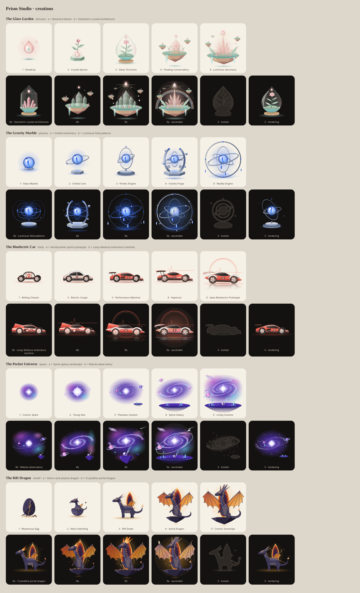

# Prism Studio

A phone-first studio for five educational channels: **Skincare**, **Rest Frame** (physics), **Meanwhile, Inside**
(human body), **Light Minute** (space) and **What If?**. It publishes to 11 places: one YouTube channel and one
TikTok account per channel, plus one shared Instagram.

It tracks every episode from idea to published, binds each approval to an exact video and text for one account,
and runs the daily routine through an **Upload Desk**. Publishing is manual until the platform integrations are
verified (Stage C). It also keeps analytics, milestones and an optional, owner-funded reward budget, and each
channel has a living creation that evolves with real work.





## Run it

```bash
service postgresql start                       # local Postgres 16
cp .env.example .env.local                     # then fill in the values below
npm install
npm run owner:password -- "your passphrase"    # prints OWNER_PASSWORD_HASH for .env.local
openssl rand -hex 32                           # SESSION_SECRET for .env.local
npm run db:migrate && npm run db:seed && npm run import:episodes
npm run dev                                    # http://localhost:3100
npm run worker                                 # second terminal: background jobs
```

Checks: `npm run typecheck`, `npm test` (needs `TEST_DATABASE_URL`; it wipes that database, never the studio's),
`npx next build`.

## Where things are

| Path | What |
|---|---|
| `src/db/schema.ts` | Every business fact (34 tables). Times are UTC; money is integer cents; production budgets and costs are separate from rewards |
| `src/domain/` | The rules: episodes and states, approvals, publications, schedule, rewards, the living studio, jobs, time |
| `src/app/(studio)/` | Screens: Home, Upload Desk, Review, Calendar, Rewards, channels, episodes, evolution, analytics, accounts, queue, costs, settings |
| `src/app/actions.ts` | Every mutation (server actions, zod-validated, owner-checked) |
| `src/app/api/` | Media with HTTP Range, the SRT captions, the per-task ZIP bundle |
| `src/creations/` | The five creations, drawn as inline SVG (forms 1–5, branches, ascended, reveal) |
| `worker/index.ts` | The job runner and housekeeping (expired leases, missed slots) |
| `scripts/` | migrate, seed, import episodes from `films/channels`, owner password, dev reset |
| `tests/` | Vitest: the failure paths (approvals, double counting, money, queue, DST, URLs, traversal) |

See `RUNBOOK.md` for day-to-day operation, `DECISIONS.md` for why things are the way they are, `INTEGRATIONS.md`
for platform links and the Stage C plan, and `PROJECT_STATE.md` for what's done and what's next.
